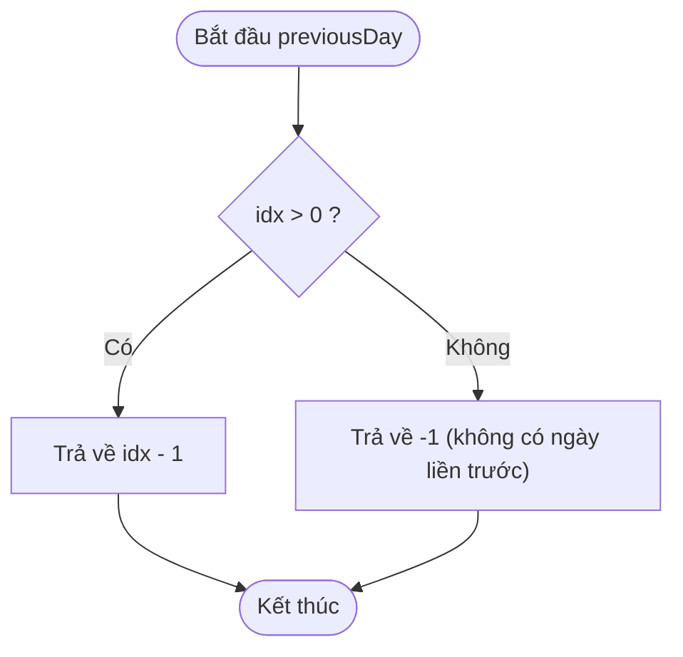
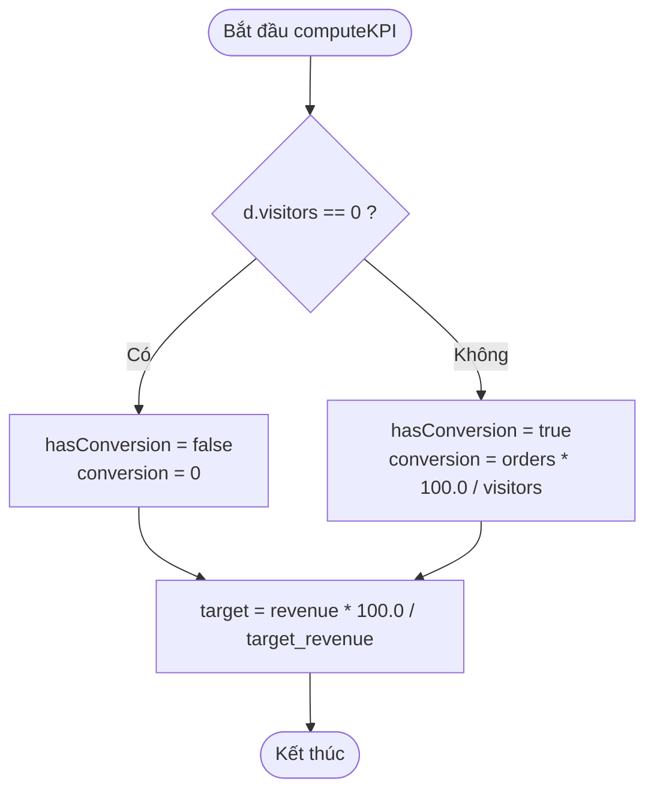
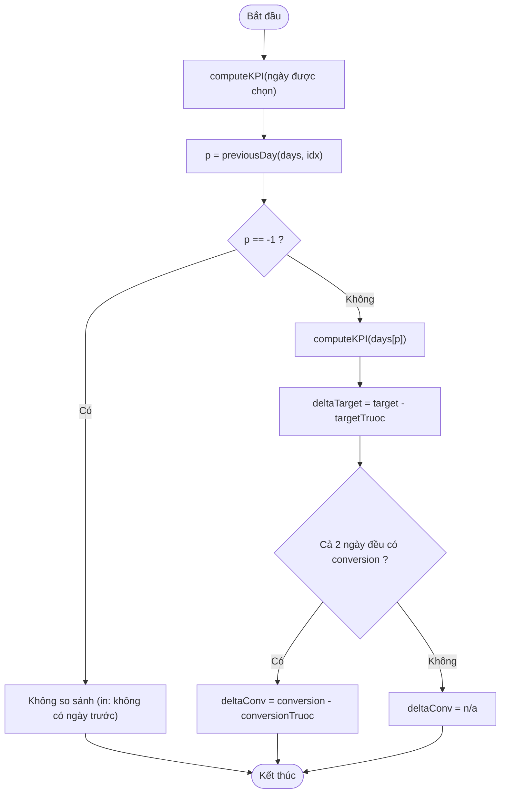

# T07 – previousDay() & computeKPI()

- **Người làm:** Long (`adamnguyen443-byte`)
- **Reviewer:** Khôi
- **File code:** `src/main.cpp` (đoạn `// === T07: previousDay, computeKPI ===`)

## 1. Mô tả

| Hàm | Đầu vào | Đầu ra | Ý nghĩa |
| :--- | :--- | :--- | :--- |
| `previousDay(days, idx)` | `days`: danh sách ngày của 1 cửa hàng (đã sắp xếp tăng dần theo ngày); `idx`: vị trí ngày được chọn | Vị trí ngày có dữ liệu liền trước, hoặc `-1` nếu không có | Dùng để so sánh tăng/giảm |
| `computeKPI(d, conversion, hasConversion, target)` | `d`: 1 bản ghi `DayRecord` | `conversion` (%), `hasConversion` (true/false), `target` (%) | Tính 2 chỉ số KPI |

Công thức:
- `Conversion = orders / visitors * 100%` — nếu `visitors == 0` (cửa hàng đóng cửa) thì **không chia**, `hasConversion = false`, khi in hiển thị `n/a`.
- `Target achievement = revenue / target_revenue * 100%` — `target_revenue = 0` đã bị loại ở T04 nên luôn chia được.
- Mức tăng/giảm = KPI ngày được chọn − KPI ngày liền trước (đơn vị: điểm %). Không có ngày liền trước, hoặc 1 trong 2 ngày có conversion `n/a` → không so sánh conversion.

## 2. Flowchart

### 2.1. previousDay()



### 2.2. computeKPI()



### 2.3. So sánh với ngày liền trước (dùng 2 hàm trên)



## 3. Pseudocode

```
HÀM previousDay(days, idx):
    NẾU idx > 0 THÌ
        TRẢ VỀ idx - 1
    NGƯỢC LẠI
        TRẢ VỀ -1
KẾT THÚC HÀM

HÀM computeKPI(d, conversion, hasConversion, target):
    NẾU d.visitors == 0 THÌ
        hasConversion ← false
        conversion ← 0
    NGƯỢC LẠI
        hasConversion ← true
        conversion ← d.orders * 100.0 / d.visitors
    target ← d.revenue * 100.0 / d.target_revenue
KẾT THÚC HÀM

// So sánh với ngày liền trước
computeKPI(days[idx], conv, hasConv, target)
p ← previousDay(days, idx)
NẾU p == -1 THÌ
    ghi nhận: không có ngày liền trước
NGƯỢC LẠI
    computeKPI(days[p], convTruoc, hasConvTruoc, targetTruoc)
    deltaTarget ← target - targetTruoc
    NẾU hasConv VÀ hasConvTruoc THÌ
        deltaConv ← conv - convTruoc
    NGƯỢC LẠI
        deltaConv ← n/a
```

## 4. Giả định

- `days` chỉ chứa các dòng hợp lệ của 1 cửa hàng (đã lọc ở T04, T05) và đã sắp xếp tăng dần theo ngày, nên "ngày có dữ liệu liền trước" chính là phần tử đứng ngay trước.
- Nhân `100.0` trước khi chia để tránh phép chia nguyên của C++.
